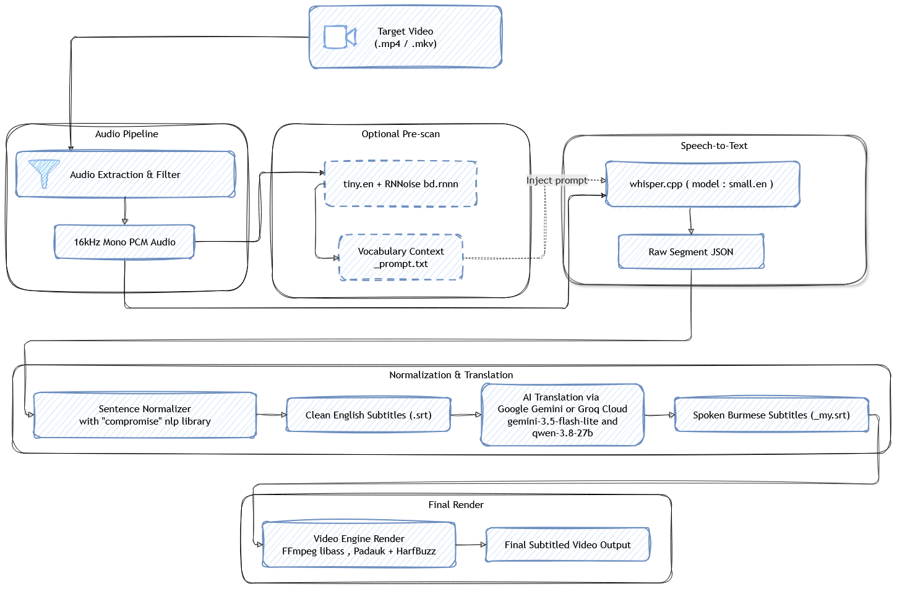

# 🏗️ MagicTitle Architecture & Model Tuning Guide (Architecture.md)

This document provides a comprehensive technical breakdown of the MagicTitle pipeline, model parameter tuning, dynamic vocabulary harvesting, and architectural trade-offs.

---

## 1. System Pipeline Architecture


---

## 2. Core Model Pair: `small.en` & `tiny.en`

The pipeline is **highly effective and fine-tuned specifically for English dialogue using `small.en` paired with `tiny.en`**.

> 📝
> **Multi-Language Status:** Multi-language speech recognition (using `small-q5` or `base` multilingual models) is **currently in progress / experimental**. The primary, production-grade engine is optimized around the English pairing.

### The Two-Pass Model Synergy
1. **Pass 1 — Vocabulary Harvester (`tiny.en`)**:
   - Ultra-fast probe pass (~77MB model).
   - Audio is isolated with RNNoise (`bd.rnnn`).
   - Runs greedy search (`beamSize: 5`, `bestOf: 5`, `maxContext: 224`) to scan proper nouns, character names, and domain terminology.
   - Outputs `<video_name>_prompt.txt`.
2. **Pass 2 — Main Acoustic Transcriber (`small.en`)**:
   - High-fidelity transcription model (~487MB model).
   - Audio processed via the **battle-tested audio filter** (no neural noise degradation).
   - Emits structured segment JSON (`-oj`) with `maxLen: 42` and `maxContext: 224`.
   - Processed by `srtNormalizer` into natural sentences.

The reason why the main model relies on ffmpeg audio filter instead of neural models is that vad (voice activity detection) and neural denoising models strip audio frequencies to get the human voice but this will cause the main model to lose accuracy in timestamps and proper vocabulary.The `small.en` model can effectively recognize the distortions and heavy explosive background noise in the audio.When it encounters the distortions it simply returns the music notes `♪♪♪` and continues to transcribe the next speech segment.The pipeline takes this advantage by simply sanitizing that music notes from model output in `srtNormalizer` and finally gets the most accurate timestamps and proper vocabulary in the final srt file while preserving the low resoruce utilization and high speed of the pipeline.


## 3. Dynamic Prompting: Mechanics & Trade-Offs
The pipline itself is designed with configurable model profiles which is just a json format of whisper.cpp command line args.Meaning you can just use the large-v3-turbo.en model or any model your machine can handle fastly.
>**Note** : If you use large-v3-turbo.en model, you will get the most accurate result and may need some config tuning to get the best result for your desired output.

### How Dynamic Context Is Extracted from `tiny.en`
1. **Probe Transcription**: `tiny.en` produces a rough draft transcript.
2. **NLP Entity Harvester (`compromise` NLP)**:
   - Filters out pronouns, verbs, common function words, and generic nouns.
   - Extracts proper nouns (character names, locations) and high-frequency domain topic nouns.
3. **Prose Construction**:
   - Formats entities into a natural context sentence:
     `"The following dialogue features [Name 1], [Name 2], and [Name 3]. Topics and context include [Topic 1] and [Topic 2]."`
   - **Why Prose over Comma Lists?** If Whisper receives a raw comma-separated list (`"A, B, C"`), Whisper mimics the prompt's punctuation style and starts outputting commas after every 2–3 words across the entire video ("Excel comma mania"). Prose forces Whisper to use natural periods, commas, and question marks.

### The Critical Trade-Offs

| Aspect | With Dynamic Prompt Active | Clean Unconditioned Context (No Prompt) |
| :--- | :--- | :--- |
| **Proper Nouns & Vocab** | **Flawless**: Corrects obscure names (e.g., *"Rosetta Stone"*, *"Intergang"*, *"Bruce Wayne"*) | Relies on base acoustic phonetics; may misspell rare names |
| **Formal vs. Spoken English**| Shifts toward **formal written English**: Normalizes informal speech and corrects colloquial grammar (e.g., `"ya"` ➔ `"you"`, `"gonna"` ➔ `"going to"`) | Preserves **raw colloquial speech** exactly as uttered by the actor |
| **Sentence Segmentation** | Tends to produce **longer, complete sentences**; Whisper treats dialogue as a continuous narrative | Produces **tighter, rapid-fire sentence cuts** matching exact acoustic breath pauses |
| **Initial Silence/Music** | **The Intro Trap**: If a video has 3–5 seconds of music/silence before speech begins, the prompt can unground Whisper's attention, causing it to lump the entire intro into the first speech turn (e.g. `00:00:00 ➔ 00:00:17`) | **Immune to Intro Music**: Whisper tags music as `♪♪♪` and starts dialogue precisely when the actor speaks |

### Practical Operational Recommendation:
- **Speech-Heavy Videos (Dialogue begins early, e.g. Test 1 & 2)**: Use the Dynamic Prompt. It fixes names and grammar without timestamp degradation.
- **Videos with Instrumental / Music Intros (e.g. Diana Test 3)**: Use the **"Skip entirely (No prompt)"** option. Whisper will give you clean 2–4 second sentences with exact timestamps.

---

## 4. Model Parameter Tuning Guide

### `small-en` (Main Transcriber)
Configured in `src/config.js`:

```javascript
'small-en': {
  id: 'small-en',
  displayName: 'Small Model (English)',
  fileName: 'ggml-small.en.bin',
  threads: 8,                  // Optimal CPU multi-threading throughput
  beamSize: 5,                 // 5-beam search prevents word dropping
  bestOf: 5,                   // Evaluates top 5 candidate decodings
  flashAttention: false,       // CPU deterministic inference (-nfa)
  noFallback: false,           // Retains temperature fallback for difficult audio
  splitOnWord: true,           // Snaps segment cuts strictly to word boundaries (-sow)
  wordTimestamps: 0.01,        // Dynamic Time Warping (DTW) millisecond alignment (-wt 0.01)
  maxLen: 42,                  // Emits ~42 char chunks for srtNormalizer to assemble
  maxContext: 224,             // Full conversational context window
  noSpeechThreshold: 0.60,     // Rejects background non-speech noise
  entropyThold: 2.4,           // Suppresses repetition loops
  noiseModelUsed: false,       // BANNED: Neural noise model disabled on main pass
  useJsonOutput: true,         // Generates segment JSON (-oj) for srtNormalizer
  maxSilenceGapMs: 750,        // Normalizer merges clauses separated by ≤750ms
  minCueDurationMs: 1200,      // Minimum display time (prevents 60ms flashing blinks)
  maxCueDurationMs: 7000,      // Maximum display time per subtitle card
  maxCharsPerLine: 42,         // Max line width before two-line visual balance
  audioFilter: 'highpass=f=70,lowpass=f=7500,alimiter=limit=-3dB:attack=5:release=50:asc=1,dynaudnorm=f=70:g=5:m=3:p=0.95:b=1:s=0',
}
```

---

## 5. Architectural Invariants (Do Not Change)

### 1. The Battle-Tested Audio Filter
```
highpass=f=70,lowpass=f=7500,alimiter=limit=-3dB:attack=5:release=50:asc=1,dynaudnorm=f=70:g=5:m=3:p=0.95:b=1:s=0
```
- **Why It Outperforms Neural Models**: Neural models (like RNNoise) strip vocal harmonics, introduce robotic distortion, and cause Whisper to drop quiet syllables in fight scenes or heavy musical scores. This DSP filter removes low rumble (<70Hz), tames harsh highs (>7500Hz), limits loud spikes (-3dB), and levels speech across soft and loud voices (`dynaudnorm`). Meaning this is the best I can do to get the best result with small models.

### 2. Banned Components on the Main Model
- **Silero VAD (`--vad`)**: Lumps entire conversation turns into coarse 15–20 second blocks until complete silence occurs.
- **Neural Noise Denoising (`arnndn`)**: Destroys subtle voice timbre needed by `small.en`.
- **Arbitrary String Truncation**: Strings must never be sliced on raw character count in JavaScript; boundaries must always occur at whole words and complete lexical tokens.

### 3. Tested Results with current configs
These are the tested results with the current configs and the generated srt files are in the testContents folder.


[Test 1 : Generated subtitles from Heavy fight sence ( greenlatern,superman,batman)](./testContents/Superman%20vs%20Batman%20&%20Green%20Lantern%20｜%20Justice%20League：%20War_sNzqnktKaPg.srt)

[Test 2 : Green Lantern and Batman talking in the tunnel](./testContents/yt-video.srt.srt)

[Test 3 : Reel with hight vocal](./testContents/test-reel.srtsrt)

[Test 4 : Normal conversation](./testContents/Batman%20&%20Wonder%20Woman%20being%20in%20love%20for%205%20minutes%20and%2033%20seconds_mbwFuZXvN34.srt)

