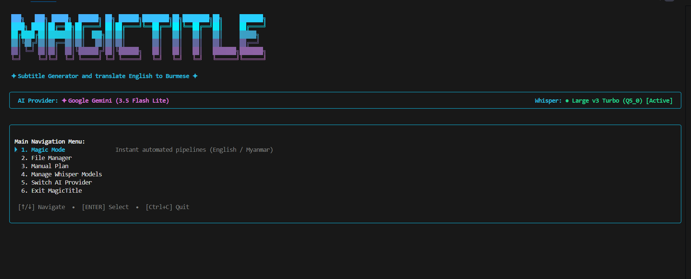
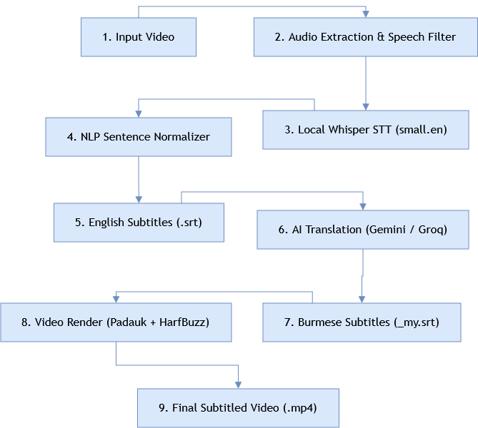

# 🧙‍♂️ MagicTitle 
Generate high-accuracy subtitles for video using local **whisper.cpp** and AI translation (**Google Gemini** & **Groq Cloud**) with flawless Myanmar font shaping (**Padauk** + **HarfBuzz**).

<p align="left">
  <a href="https://nodejs.org/"></a>
  <a href="https://github.com/ggerganov/whisper.cpp"></a>
  <a href="https://ffmpeg.org/"></a>
  <a href="https://github.com/vadimdemedes/ink"></a>
  <a href="https://ai.google.dev/"></a>
  <a href="https://groq.com/"></a>
</p>


---

## 🌟 Overview

**MagicTitle** is a terminal application designed to break language barriers by turning video dialogue into clean English and conversational Myanmar (Burmese) subtitles. It integrates local speech-to-text (**whisper.cpp**), advanced audio preprocessing (**FFmpeg**), intelligent AI translation (**Google Gemini** & **Groq Cloud**), and complex script font shaping (**HarfBuzz** + **Padauk**) into an elegant terminal interface built with **React** and **Ink**.The goal is to help the subtitling process be faster with minimum resource utilization, while maintaining high accuracy and natural language flow.



---

## ✨ Key Features

### 🎙️ 1. High-Accuracy Local Speech Recognition
- **Engineered for `small.en` + `tiny.en`**: Fast, highly effective local transcription on CPU with zero cloud costs or data leaks.
- **Dynamic Vocabulary Harvesting**: Optional fast probe pass with `tiny.en` to extract proper nouns, character names, and domain terms for maximum spelling precision.
- **Full Prompt Flexibility**: Choose to **reuse an existing prompt**, **re-run a fresh probe**, or **skip entirely** to transcribe with clean, unconditioned audio context.
- **Battle-Tested Audio Filter**: Preserves vocal dynamics while attenuating rumble and high-frequency noise with dynamic audio leveling (`dynaudnorm`).
- *(Note: Multi-language speech recognition is currently experimental / in progress)*.

### 🌐 2. Spoken Myanmar Unicode Translation (Gemini & Groq)
- **Natural Conversational Spoken Burmese (စကားပြောစစ်စစ်)**: Film subtitle system prompts that avoid stiff bookish grammar (replaces formal endings like *သည်, ၏, ၌, ပါသည်* with natural conversational speech *တယ်, ပါ, ဖြစ်လို့လေ, ဗျာ*).
- **Dual AI Providers**:
  - **Google Gemini**: Uses official `@google/genai` SDK (`gemini-3.5-flash-lite`).
  - **Groq Cloud**: Ultra-fast inference with `qwen/qwen3.8-27b` via OpenAI-compatible endpoints.
- **Fault-Tolerant Batching**: Intelligent cue chunking (45 cues/batch) with index protection, retry backoffs, and delimiter validation.

### 🎨 3. Flawless Myanmar Font Shaping & Video Burn-in
- **Padauk & HarfBuzz Integration**: Eliminates standard FFmpeg Burmese rendering bugs (stacked consonants, medial consonants, diacritics / အက္ခရာဆင့်, ယပင့်, ရရွတ်, ဝဆွဲ, ဟထိုး) by dynamically converting SRT to Advanced SubStation Alpha (`.ass`) with `shaping=complex` and embedded `Padauk` font definitions.
- **Hard Burn Mode**: Permanently burns styled subtitles into video pixels (`libass`).
- **Soft Mux Mode**: Rapidly muxes selectable subtitle tracks (`mov_text`) into video containers without re-encoding.

### 🖥️ 4. Beautiful Interactive Terminal UI (Ink + React)
- **Interactive TUI**: Arrow-key navigation, real-time spinner status, and persistent execution log history.
- **⚡ Magic Mode**: End-to-end automated pipeline with smart detection to reuse existing `.srt` and prompt files.
- **🛠️ Manual Planner**: Fine-grained modular control to toggle individual steps (Extract Audio, Probe, Transcribe, Translate, Render).
- **📁 File Manager & Dashboard**: Scans directories, shows status badges (`[EN: READY]`, `[MY: READY]`, `[PROMPT: READY]`, `[SUBTITLED]`), and features a built-in paginated **SRT Viewer**.
- **🔄 Instant Provider Switcher**: Toggle between Google Gemini and Groq on the fly.

---

## 📂 Project Structure

```
Subtitle Maker/
├── bin/
│   └── magictitle.js               # CLI executable entry point
├── fonts/
│   └── Padauk/                     # Padauk Unicode fonts for HarfBuzz shaping
│       ├── Padauk-Regular.ttf
│       ├── Padauk-Bold.ttf
│       └── OFL.txt
├── models/                         # Whisper GGML models
│   ├── ggml-small.en.bin           # Primary high-accuracy English model
│   ├── ggml-tiny.en.bin            # Fast vocabulary harvester probe model
│   └── bd.rnnn                     # Voice isolation model for probe pass
├── ffmpeg-8.1-essentials_build/    # Portable FFmpeg binaries
├── whisper-bin-x64/                # Portable whisper.cpp Windows binaries
├── src/
│   ├── index.js                    # Terminal bootstrap & banner renderer
│   ├── app.js                      # Main Ink application state & orchestrator
│   ├── config.js                   # Environment & runtime configuration
│   ├── core/
│   │   ├── ffmpeg.js               # Audio extraction, subtitle burning & muxing
│   │   ├── whisper.js              # whisper.cpp child process runner
│   │   ├── srt.js                  # SRT parser, stringifier & sanitization
│   │   ├── srtNormalizer.js        # Full-sentence NLP normalizer
│   │   ├── probeManager.js         # Vocabulary probe manager
│   │   ├── keywordExtractor.js     # NLP proper noun & topic noun extractor
│   │   ├── fontPatcher.js          # ASS script generator with Padauk styling
│   │   ├── fileScanner.js          # Video discovery & status badge detection
│   │   └── paths.js                # Binary & model resolver
│   ├── services/
│   │   ├── googleService.js        # Google Gemini AI translation integration
│   │   ├── groqService.js          # Groq Cloud AI translation integration
│   │   └── translator.js           # Batch translation orchestrator & retries
│   └── ui/
│       ├── Banner.js               # Branded ASCII banner & status bar
│       ├── MainMenu.js             # Root interactive navigation menu
│       ├── MagicModeView.js        # Quick-start automated workflow view
│       ├── ManualPlannerView.js    # Step-by-step modular pipeline planner
│       ├── FileManagerView.js      # Video manager & subtitle status dashboard
│       ├── SrtViewer.js            # Paginated terminal subtitle reader
│       └── ProviderSelector.js     # AI translation provider switcher
├── testContents/                   # Working directory for media & subtitles
├── .env.example                    # Template environment variables
├── Architecture.md                 # Deep pipeline architecture & tuning guide
├── AGENT.md                        # Agent operational constraints reference
├── package.json                    # Node.js dependencies & scripts
└── README.md                       # Project documentation
```

---

## 🚀 Getting Started

### Prerequisites
- **Node.js**: v18.0.0 or higher
- **Operating System**: Windows 10/11 (x64)

### 1. Installation
Clone or navigate to the repository directory and install dependencies:

```bash
npm install
```

### 2. Environment Configuration
Create a `.env` file in the root directory:

```env
# Google Gemini Configuration
GEMINI_API_KEY=your_gemini_api_key_here
GEMINI_MODEL=gemini-3.5-flash-lite

# Groq Configuration
GROQ_API_KEY=your_groq_api_key_here
GROQ_MODEL=qwen/qwen3.8-27b

# Defaults
DEFAULT_TRANSLATION_SERVICE=google
WHISPER_THREADS=8
```

> 💡 **Tip:** You can obtain a free Google Gemini API key from [Google AI Studio](https://aistudio.google.com/) and a Groq API key from [Groq Console](https://console.groq.com/).This keys are required only when you want to translate with this pipline but you can just copy the generated srt file,and translate it with other ai or edit it. If you finally get what you want,move the .srt or subtitle burned video to your prefered path otherwise it will be overwritten by the next run of the pipline.


---

## 🎮 Usage

### Launching the Application

```bash
npm start
```

### Workflow Options in Magic Mode:
1. **Target Video**: Select a video from `testContents/`.
2. **Workflow**: Choose **Quick English Subtitles** or **English to Burmese Subtitles**.
3. **Smart Reuse & Prompt Options**:
   - If an `.srt` exists, choose to reuse it directly or re-transcribe.
   - If a prompt file exists, choose to **reuse the saved prompt**, **re-run fresh probe**, or **skip entirely** (recommended for videos with long musical intros).
4. **Output Mode**: Choose **🔥 Hard Burn** (permanent) or **⚡ Soft Mux** (fast container mux).

---

## ⚙️ Configuration Options


| Option | Environment Variable | Default | Description |
| :--- | :--- | :--- | :--- |
| **Gemini API Key** | `GEMINI_API_KEY` | `""` | Google AI Studio API key |
| **Gemini Model** | `GEMINI_MODEL` | `gemini-3.5-flash-lite` | Gemini model ID for translation |
| **Groq API Key** | `GROQ_API_KEY` | `""` | Groq Cloud API key |
| **Groq Model** | `GROQ_MODEL` | `qwen/qwen3.8-27b` | Groq model ID for translation |
| **Default Service**| `DEFAULT_TRANSLATION_SERVICE` | `google` | Default provider (`google` or `groq`) |
| **Whisper Threads**| `WHISPER_THREADS` | `8` | CPU threads allocated to whisper.cpp |

---
## Limitations
 While this tool is designed for fully automated subtitle generation,time stamps of subtitles may not be perfectly aligned with the actual speech in the video or audio because of small.en. mullingual support is not fully implemented yet.The reason why the small.en is mainly used is , it can pefectly recongnize the distortions and background noise in the audio.You can check the detail in the following section.
## 📚 Technical Documentation

- **[Architecture.md](./Architecture.md)**: Architectural design, model parameter tuning (`small.en` & `tiny.en`), dynamic prompt mechanics, and trade-off analysis.
- **[AGENT.md](./AGENT.md)**: Hard architectural constraints, model invariants, and operational guidelines.
